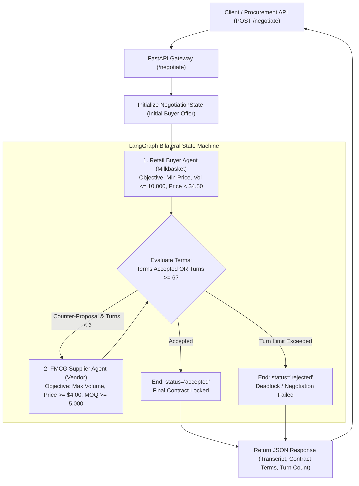

# Autonomous A2A Vendor Negotiation Arena

An autonomous Agent-to-Agent (A2A) bilateral procurement negotiation game built using **FastAPI**, **LangGraph**, and **Groq's OpenAI-compatible endpoint** running `openai/gpt-oss-120b`.

The system simulates a live commercial negotiation between an enterprise retail buyer (**Milkbasket Category Sourcing Lead**) and an **FMCG Manufacturer Key Accounts Director**. Both agents engage in iterative, multi-turn game-theoretic bargaining over price, order volume, and fulfillment lead times to converge upon a legally and financially binding purchase agreement within a 6-turn limit.

---

## 🏛️ System Architecture



---

## 📋 Bilateral Game Constraints & Payoff Dynamics

| Commercial Parameter | Retail Buyer Agent (Milkbasket) | FMCG Supplier Agent (Vendor) |
| :--- | :--- | :--- |
| **Primary Incentive** | Minimize unit procurement cost to maximize retail gross margin | Maximize volume commitment and plant revenue |
| **Price Guardrails** | Strictly **< $4.50** (Target: $3.80 – $4.10) | Strictly **$\ge$ $4.00** (Refuses < $4.00) |
| **Volume Envelope** | Hard ceiling: **$\le$ 10,000 units** (working capital limit) | Minimum Order Quantity (MOQ): **$\ge$ 5,000 units** |
| **Delivery SLA** | Demands fast replenishment ($\le$ 3–5 business days) | Standard manufacturing lead time (4–7 business days) |
| **Zone of Agreement (ZOPA)** | Price $\le$ $4.20$ & Volume $\le$ 10,000 | Price $\ge$ $4.15$ & Volume $\ge$ 6,000 |

Mutual agreement converges within the ZOPA between **$4.15 and $4.20 per unit** with volume between **6,000 and 10,000 units**.

---

## 📂 Project Structure

```
A2A-Vendor-Negotiation-Arena/
├── requirements.txt      # fastapi, uvicorn, langchain, langgraph, pydantic
├── schemas.py            # Offer, AgentTurnResponse, and NegotiationState schemas
├── agents.py             # Buyer and Supplier agent nodes with Groq openai/gpt-oss-120b
├── graph.py              # LangGraph bilateral state machine and conditional edges
├── main.py               # FastAPI application with POST /negotiate and CLI scorecard
└── README.md             # Documentation
```

---

## ⚡ Quickstart

### 1. Installation
Install project dependencies:
```bash
pip install -r requirements.txt
```

### 2. Configure Groq API Key (Optional)
To use live high-speed inference with `openai/gpt-oss-120b`, set your Groq API key:
```bash
export GROQ_API_KEY="your-groq-api-key"
# Windows PowerShell:
# $env:GROQ_API_KEY="your-groq-api-key"
```
*(Note: If no API key is detected, the arena automatically executes with deterministic bilateral game logic).*

### 3. Run Standalone Simulation CLI
```bash
python main.py
```

### 4. Launch FastAPI REST Server
```bash
python main.py --server
# Or directly via uvicorn:
# uvicorn main:app --host 0.0.0.0 --port 8000 --reload
```
Interactive Swagger API documentation will be available at: `http://localhost:8000/docs`

---

## 📡 API Usage Example

### POST `/negotiate`
**Request Payload:**
```json
{
  "product_name": "Aashirvaad Superior MP Whole Wheat Atta 5kg",
  "initial_offer": {
    "price_per_unit": 3.90,
    "volume": 8000,
    "delivery_days": 3
  },
  "turn_limit": 6
}
```

**Response Payload:**
```json
{
  "status": "accepted",
  "product_name": "Aashirvaad Superior MP Whole Wheat Atta 5kg",
  "total_turns": 5,
  "final_agreed_terms": {
    "price_per_unit": 4.15,
    "volume": 8700,
    "delivery_days": 5
  },
  "agreement_summary": "Agreement achieved on Turn 5: Buyer accepted supplier terms at $4.15/unit for 8,700 units.",
  "transcript": [
    {
      "turn": 1,
      "speaker": "Buyer (Milkbasket)",
      "action": "propose_counter",
      "offer": { "price_per_unit": 3.90, "volume": 8000, "delivery_days": 3 },
      "message": "Milkbasket opening proposal for Aashirvaad Superior MP Whole Wheat Atta 5kg: $3.90/unit for 8,000 units with 3-day delivery lead time."
    },
    {
      "turn": 2,
      "speaker": "Supplier (FMCG Vendor)",
      "action": "propose_counter",
      "offer": { "price_per_unit": 4.26, "volume": 8500, "delivery_days": 5 },
      "message": "A price of $3.90 is below our manufacturing breakeven. However, for a committed volume of 8,500 units, we can discount our price to $4.26 with 5 days delivery."
    },
    {
      "turn": 5,
      "speaker": "Buyer (Milkbasket)",
      "action": "accept",
      "offer": { "price_per_unit": 4.15, "volume": 8700, "delivery_days": 5 },
      "message": "We accept your proposed price of $4.15 for 8,700 units with 5-day delivery. This fits within Milkbasket's margin parameters."
    }
  ]
}
```
